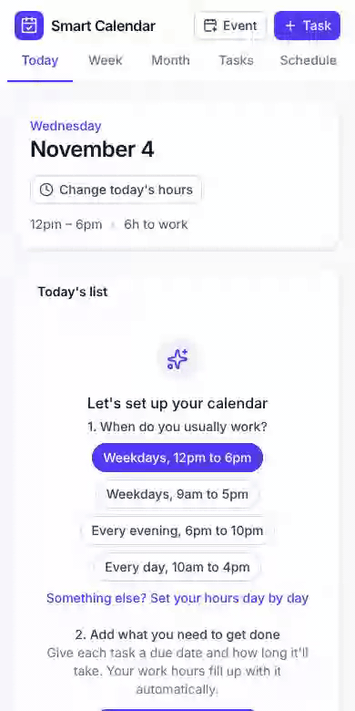
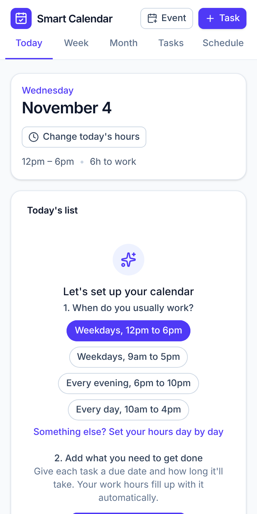
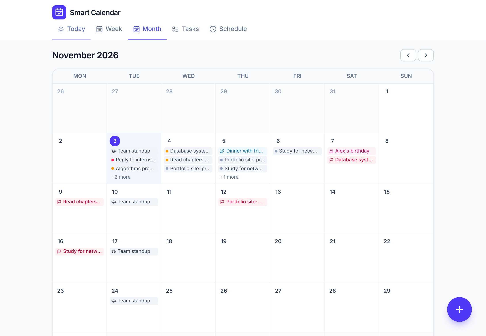
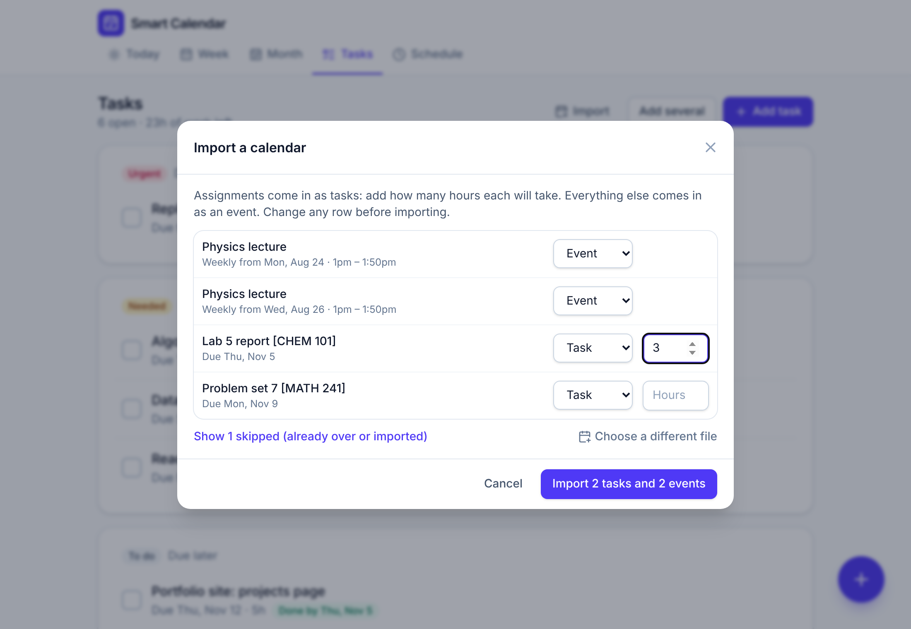

# Smart Calendar

A calendar that turns your deadlines and free hours into a daily to-do list.

Add what you need to get done, how long you think it'll take, and when it's due. Set the hours you can work each day. Smart Calendar fills those hours with the right work, so even on a day when nothing is due you keep chipping away at what's coming and stay ahead.

**[Live demo →](https://zriedel04.github.io/smart-calendar/)** (click "Try it with sample tasks")

<p align="center">
  
</p>

<p align="center">
  
  
  
  
  
</p>

<p align="center">
  
</p>

<p align="center">
  
</p>

## Features

- **A daily checklist built for you.** Each day's list adds up to the hours you have free. Tick items off as you go.
- **Stays ahead of deadlines.** Work due next week gets pulled forward into today's free time instead of piling up the night before.
- **Usual hours, with one-off changes.** Set default hours for each weekday (say, Mondays 12pm to 6pm), then change a single date (this Monday, 12pm to 4pm) without touching the others.
- **Month calendar.** See planned work and due dates on every day, crossed off as you finish them, or switch to due dates only for a view like your school calendar.
- **Add several tasks at once.** Enter a batch of assignments in one form.
- **Re-plans instantly.** Change your hours, add a task, or tick something off and every day's list updates.
- **Priorities at a glance.** Due today is **Urgent**, due within a week is **Needed**, anything later is **To do**, and missed due dates are **Overdue**.
- **Events, plans and birthdays.** Add classes, shifts, plans with friends and birthdays, timed or all day, one-time, weekly (with an end date, like the end of the semester), monthly or yearly. Choose whether each one takes time away from work.
- **Import from Canvas or any calendar.** Load an .ics file from Canvas, Google Calendar, Apple Calendar or Outlook. Assignments come in as tasks (you just add the hours), everything else as events, and you see a preview first. Importing the same file again won't add duplicates.
- **Quick to set up, easy to fix mistakes.** Pick your usual hours with one tap on first launch. Ticked something off by accident, or deleted the wrong task? Hit Undo.
- **Events like a real calendar.** Repeat every day, on weekdays, every 2 weeks, monthly on a date or on "the 3rd Thursday", or yearly. Give events a place (one tap opens it in Maps) and notes, and make all-day events, like a trip, run several days. Change or cancel just one day of a repeating event, like a class that moved rooms or was called off.
- **Search everything.** The magnifier at the top (or the / key) finds tasks and events by name, place or notes, and shows when each event happens next.
- **Clear things out fast.** Pick tasks on a day to delete them together, pick whole days on the month calendar to clear everything due on them, or delete the whole calendar from the Danger zone after typing a confirmation.
- **Early warnings.** If a task can't be finished before it's due with your current hours, it's flagged as at risk.
- **Suggested times.** Each item on Today's list shows when to work on it, like "1:30pm – 4:30pm", fitted around your classes and plans and starting from now. The Week view shows start times too. Turn them off with one tap.
- **Pick the day.** Drag a task to another day in the Week view, or set "Work on it on" when you add it, and it goes first on that day's list. Whatever doesn't fit carries on to the next days.
- **Timer.** Start a timer on any item on Today's list. It stays at the top of every screen, survives a reload, and logs the time when you stop it.
- **Log part of an item, or push it to tomorrow.** Did 1 hour of a 2-hour block? Log just that, and the rest stays on the list. Not getting to something today? Push it to tomorrow and today's time goes to the next task.
- **Repeating tasks.** "Study Spanish, 1 hour every weekday" or "Laundry every Sunday": each day gets its own item, planned on that day, even a day off. Missed days are skipped instead of piling up.
- **Unfinished work rolls over.** Anything you don't get to is rescheduled from the next day automatically.
- **Calendar links that stay up to date.** Signed in, paste your Canvas, Google Calendar or Outlook link once. New assignments come in as tasks with your usual estimate, changed due dates and times update, and cancelled events disappear. Your own edits and deletions stick. Canvas titles are shortened to the course code ("Sprint 4 Report · CSE 485"), and you can leave out courses you don't want.
- **Sync across devices, if you want it.** Sign in with an emailed link and your phone and laptop share one calendar. Changes made offline on two devices are merged item by item, so nothing is lost. No account needed to use the app.
- **Works offline and installs like an app.** It's a PWA, so you can add it to your phone's home screen. Without an account, data stays in your browser, with JSON export and import for backups.
- **Light and dark mode**, following your system setting.

## How the scheduler works

The scheduler ([`src/lib/scheduler.ts`](src/lib/scheduler.ts)) is a pure function with no React or browser dependencies, so it's straightforward to test.

1. **Work out each day's capacity.** For every date, take that day's hours (a one-day override if there is one, otherwise the weekday default), then cut out any events that block work ([`src/lib/availability.ts`](src/lib/availability.ts)). Today's capacity also drops by the time you've already ticked off, so checking something off never reshuffles the rest of today's list.
2. **Sort the work by due date** (earliest first). Ties go to the smaller task, then the older one.
3. **Fill each day to capacity**, starting today, walking the sorted list. A task that doesn't fit is split, and the rest carries over to the next day with free time. Slices under 15 minutes are skipped unless they finish the task, and the gap goes to a smaller task that fits.
4. **Forecast each task's finish date** and flag any that land after their due date.

Filling every day completely is what pulls future work forward. Doing work in due-date order (earliest deadline first) is optimal when work can be split across days: if any plan can finish everything on time, this one does.

Because the plan is recomputed from your tasks, your hours and your logged work every time something changes, there's no stored schedule to get out of sync.

## How sync works

Signed in, the whole calendar is one row in a Supabase Postgres table ([`supabase/schema.sql`](supabase/schema.sql)), protected by row-level security so each account can only reach its own row.

- **Every save is checked against a version number**, so a device can't overwrite a save it hasn't seen. If another device saved first, the app fetches that save, merges, and tries again.
- **Merging is three-way** ([`src/sync/merge.ts`](src/sync/merge.ts)). Each device remembers the version it last agreed on with the account. Comparing both sides with it tells a deletion apart from an addition, so a task deleted on the phone stays deleted, and tasks added on each device are both kept. If the same task was edited on both, this device's edit wins.
- **Changes reach other open devices right away** through Supabase Realtime, and the app also catches up when you come back to it or reconnect.
- **The first time a device that already has data signs in** to an account that has a different calendar, it asks which one to keep. Nothing is replaced or synced until you choose.

Calendar links are fetched by a small Supabase Edge Function ([`supabase/functions/fetch-feed`](supabase/functions/fetch-feed/index.ts)), because calendar servers like Canvas don't let other sites read their feeds from the browser. It only works for signed-in users and only fetches public https links. Each device refreshes links when the app opens and every few hours, and [`applyFeed`](src/state/feeds.ts) brings the calendar up to date. Items from a link have the same id on every device, so two devices refreshing at once don't add anything twice.

The sync logic ([`src/sync/engine.ts`](src/sync/engine.ts)) talks to a small storage interface, so the tests run it against an in-memory store, including two devices saving at the same moment.

## Tech stack

- [React 19](https://react.dev) and [TypeScript](https://www.typescriptlang.org)
- [Vite](https://vite.dev) for builds, with [vite-plugin-pwa](https://vite-pwa-org.netlify.app) for offline support and install
- [Tailwind CSS 4](https://tailwindcss.com) for styling and [Lucide](https://lucide.dev) icons
- [Supabase](https://supabase.com) for optional accounts (email sign-in links or codes), a Postgres table with row-level security, and Realtime updates
- [Vitest](https://vitest.dev) and [Testing Library](https://testing-library.com) for tests, [Oxlint](https://oxc.rs) for linting
- GitHub Actions for CI and deployment to GitHub Pages

## Project structure

```
src/
  lib/          Pure logic: dates, time ranges, availability, priorities, the scheduler, the .ics parser
  state/        App data types, reducer, local storage, and planFor() which connects data to the scheduler
  sync/         Accounts and sync: the three-way merge, the sync engine, and the Supabase connection
  components/   Shared UI: buttons, cards, modals, task / event / hours forms
  views/        The screens: Today, Week, Month, Tasks, Schedule
  App.tsx       Layout, navigation and dialogs
```

## Getting started

You need Node.js 22 or newer.

```bash
npm install
npm run dev        # start the dev server at http://localhost:5173
```

| Command             | What it does                                   |
| ------------------- | ---------------------------------------------- |
| `npm run dev`       | Start the dev server                           |
| `npm test`          | Run the test suite once                        |
| `npm run test:watch`| Run tests in watch mode                        |
| `npm run lint`      | Lint with Oxlint                               |
| `npm run typecheck` | Type-check the project                         |
| `npm run build`     | Type-check and build for production in `dist/` |

## Testing

The scheduler, availability rules, date handling and state reducer have unit tests, and [`src/App.test.tsx`](src/App.test.tsx) drives the real UI through the core flow: add a task, see it fill today's hours, change today's hours, and tick it off.

Dates are stored as plain `YYYY-MM-DD` strings and all date math runs in UTC, so daylight-saving changes can't shift a day (there are tests for that too).

## Deployment

Every push to `main` runs the tests and deploys to GitHub Pages through [`.github/workflows/deploy.yml`](.github/workflows/deploy.yml). Pull requests run lint, type-check, tests and a build through [`.github/workflows/ci.yml`](.github/workflows/ci.yml).

To deploy your own copy, enable GitHub Pages under **Settings → Pages → Build and deployment → Source: GitHub Actions**.

To use your own Supabase project for accounts:

1. Create a project, then run [`supabase/schema.sql`](supabase/schema.sql) in its SQL Editor.
2. Under **Authentication → URL Configuration**, set the Site URL to your deployed app and add it (and `http://localhost:5173/**`) to the Redirect URLs.
3. Under **Authentication → Emails → Magic Link**, add the code to the email, for example `<p>Or type this code in the app: {{ .Token }}</p>`. The code signs you in when the link would open in a different browser, or from an app added to a phone's home screen.
4. For calendar links, deploy [`supabase/functions/fetch-feed/index.ts`](supabase/functions/fetch-feed/index.ts) as an Edge Function named `fetch-feed`, with JWT verification turned off (the function checks the signed-in user itself).
5. Build with `VITE_SUPABASE_URL` and `VITE_SUPABASE_PUBLISHABLE_KEY` set to your project's URL and publishable key.

## Roadmap

- Importing assignments from a screenshot

## License

[MIT](LICENSE)
