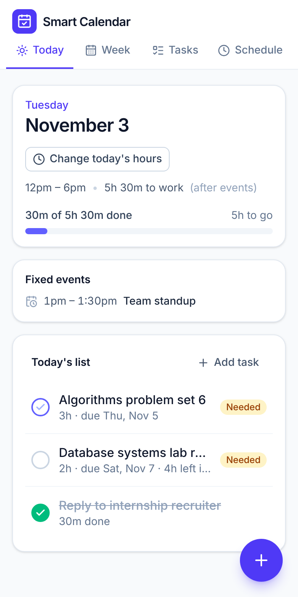
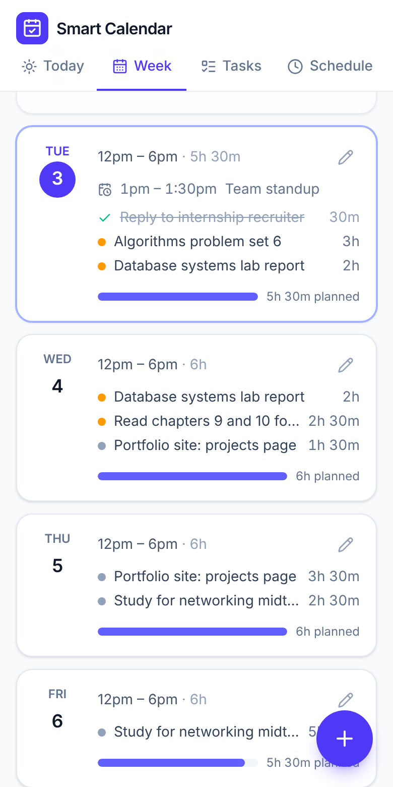
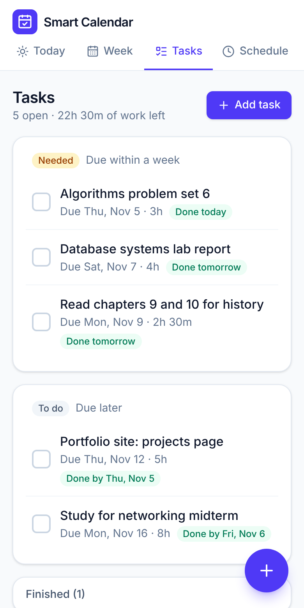
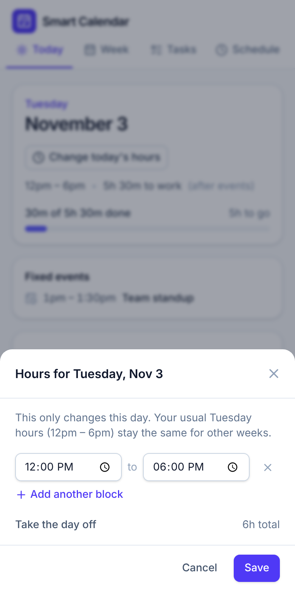

# Smart Calendar

A calendar that turns your deadlines and free hours into a daily to-do list.

Add what you need to get done, how long you think it'll take, and when it's due. Set the hours you can work each day. Smart Calendar fills those hours with the right work, so even on a day when nothing is due you keep chipping away at what's coming and stay ahead.

**[Live demo →](https://zriedel04.github.io/smart-calendar/)** (click "Try it with sample tasks")

<p align="center">
  
  
  
  
</p>

## Features

- **A daily checklist built for you.** Each day's list adds up to the hours you have free. Tick items off as you go.
- **Stays ahead of deadlines.** Work due next week gets pulled forward into today's free time instead of piling up the night before.
- **Usual hours, with one-off changes.** Set default hours for each weekday (say, Mondays 12pm to 6pm), then change a single date (this Monday, 12pm to 4pm) without touching the others.
- **Re-plans instantly.** Change your hours, add a task, or tick something off and every day's list updates.
- **Priorities at a glance.** Due today is **Urgent**, due within a week is **Needed**, anything later is **To do**, and missed due dates are **Overdue**.
- **Fixed events.** Classes, shifts and appointments (one-time or weekly) are taken out of your work hours.
- **Early warnings.** If a task can't be finished before it's due with your current hours, it's flagged as at risk.
- **Unfinished work rolls over.** Anything you don't get to is rescheduled from the next day automatically.
- **Works offline and installs like an app.** It's a PWA, so you can add it to your phone's home screen. Data stays in your browser, with JSON export and import for backups.
- **Light and dark mode**, following your system setting.

## How the scheduler works

The scheduler ([`src/lib/scheduler.ts`](src/lib/scheduler.ts)) is a pure function with no React or browser dependencies, so it's straightforward to test.

1. **Work out each day's capacity.** For every date, take that day's hours (a one-day override if there is one, otherwise the weekday default), then cut out any fixed events ([`src/lib/availability.ts`](src/lib/availability.ts)). Today's capacity also drops by the time you've already ticked off, so checking something off never reshuffles the rest of today's list.
2. **Sort the work by due date** (earliest first). Ties go to the smaller task, then the older one.
3. **Fill each day to capacity**, starting today, walking the sorted list. A task that doesn't fit is split, and the rest carries over to the next day with free time. Slices under 15 minutes are skipped unless they finish the task, and the gap goes to a smaller task that fits.
4. **Forecast each task's finish date** and flag any that land after their due date.

Filling every day completely is what pulls future work forward. Doing work in due-date order (earliest deadline first) is optimal when work can be split across days: if any plan can finish everything on time, this one does.

Because the plan is recomputed from your tasks, your hours and your logged work every time something changes, there's no stored schedule to get out of sync.

## Tech stack

- [React 19](https://react.dev) and [TypeScript](https://www.typescriptlang.org)
- [Vite](https://vite.dev) for builds, with [vite-plugin-pwa](https://vite-pwa-org.netlify.app) for offline support and install
- [Tailwind CSS 4](https://tailwindcss.com) for styling and [Lucide](https://lucide.dev) icons
- [Vitest](https://vitest.dev) and [Testing Library](https://testing-library.com) for tests, [Oxlint](https://oxc.rs) for linting
- GitHub Actions for CI and deployment to GitHub Pages

## Project structure

```
src/
  lib/          Pure logic: dates, time ranges, availability, priorities, the scheduler
  state/        App data types, reducer, local storage, and planFor() which connects data to the scheduler
  components/   Shared UI: buttons, cards, modals, task / event / hours forms
  views/        The four screens: Today, Week, Tasks, Schedule
  App.tsx       Layout, navigation and dialogs
```

## Getting started

You need Node.js 22 or newer.

```bash
npm install
npm run dev        # start the dev server at http://localhost:5173
```

| Command             | What it does                                   |
| ------------------- | ---------------------------------------------- |
| `npm run dev`       | Start the dev server                           |
| `npm test`          | Run the test suite once                        |
| `npm run test:watch`| Run tests in watch mode                        |
| `npm run lint`      | Lint with Oxlint                               |
| `npm run typecheck` | Type-check the project                         |
| `npm run build`     | Type-check and build for production in `dist/` |

## Testing

The scheduler, availability rules, date handling and state reducer have unit tests, and [`src/App.test.tsx`](src/App.test.tsx) drives the real UI through the core flow: add a task, see it fill today's hours, change today's hours, and tick it off.

Dates are stored as plain `YYYY-MM-DD` strings and all date math runs in UTC, so daylight-saving changes can't shift a day (there are tests for that too).

## Deployment

Every push to `main` runs the tests and deploys to GitHub Pages through [`.github/workflows/deploy.yml`](.github/workflows/deploy.yml). Pull requests run lint, type-check, tests and a build through [`.github/workflows/ci.yml`](.github/workflows/ci.yml).

To deploy your own copy, enable GitHub Pages under **Settings → Pages → Build and deployment → Source: GitHub Actions**.

## Roadmap

- Accounts and cloud sync so your phone and laptop share the same data
- Logging part of a task (for example, 1 hour of a 2-hour block)
- Recurring tasks
- Importing events from Google Calendar
- Optional time-blocking: suggested start times within your work hours

## License

[MIT](LICENSE)
